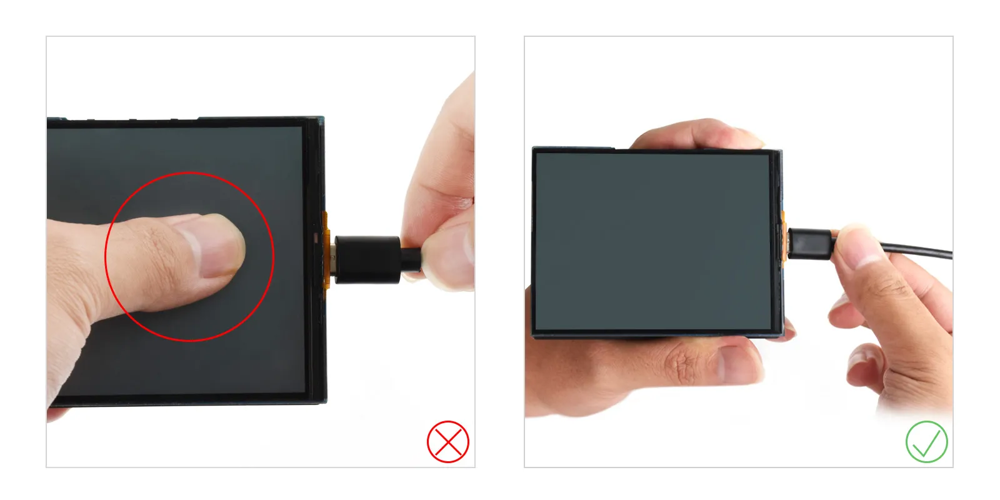
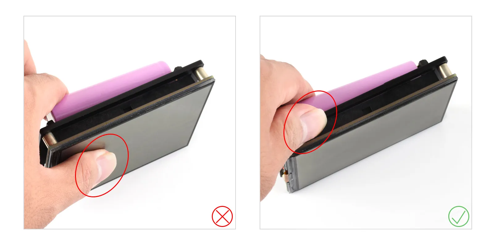
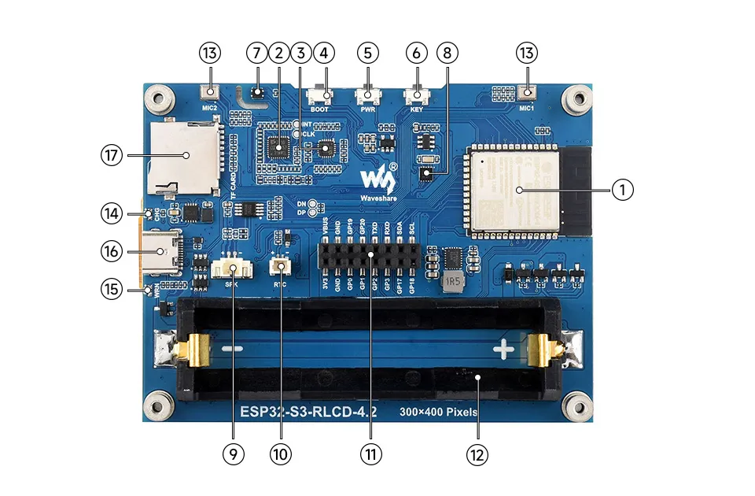
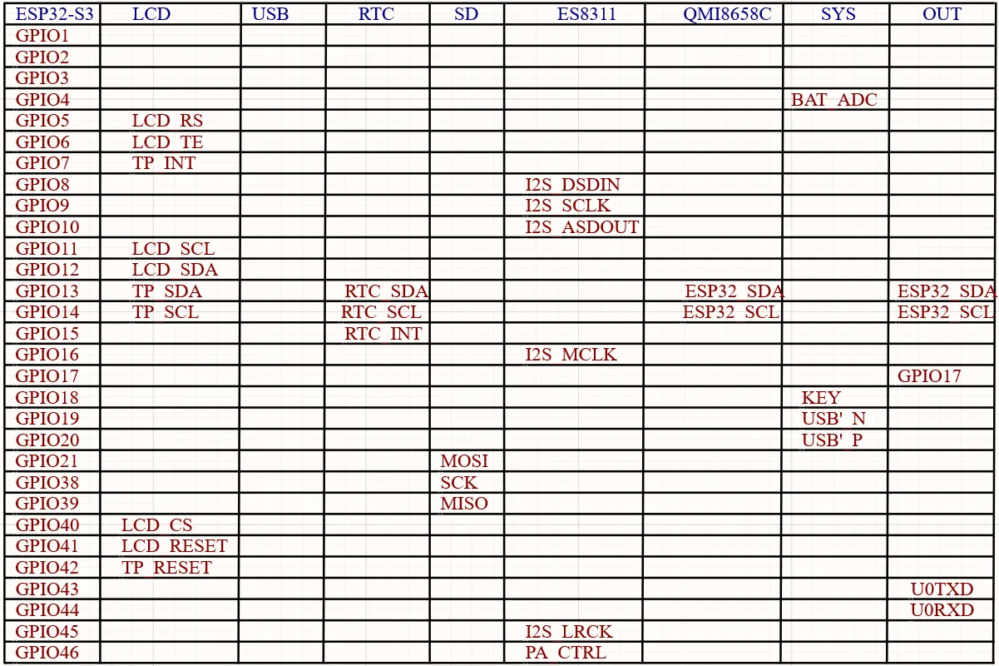
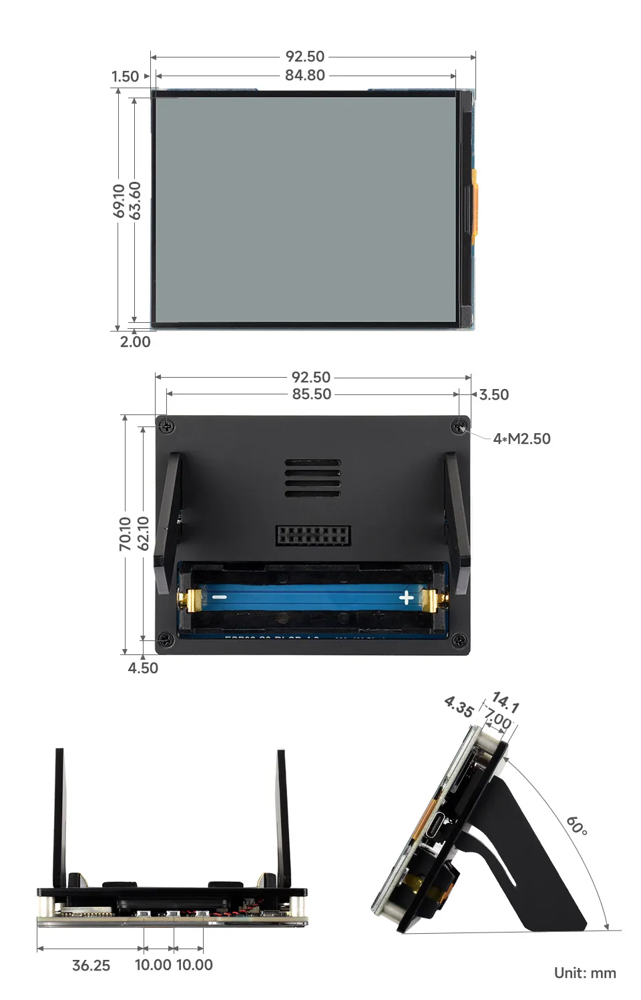

# ESP32-S3-RLCD-4.2

> 来源: https://docs.waveshare.net/ESP32-S3-RLCD-4.2

> **版本兼容性说明**
>
> 自 2026 年 10 月 10 日起，本产品开始出货 V2 版本。为降低液晶屏受力损坏的风险，V2 版本更换了亚克力隔板，因此隔板厚度较 V1 版本有所增加；其他部分保持不变。
>
> V1 与 V2 可通过产品上的 QC 标签区分。
>
> V2 版本的结构尺寸变化如下：
>
> - 液晶与亚克力之间的厚度由 3.75 mm 调整为 4.35 mm
> - 总厚度由 13.50 mm 调整为 14.1 mm
>
> 如需自行设计或制作后壳，请以收到产品后的实际测量尺寸为准，并为屏幕及隔板预留足够空间，避免装配挤压造成液晶屏损坏。

本产品是一款基于 ESP32-S3 的全反射屏 AIoT 开发板，支持 Wi-Fi 与 BLE 双模通信，搭载 4.2 英寸全反射显示屏 (RLCD)，低功耗，显示效果接近墨水屏，更快的刷新响应。板载音频编解码电路、双麦克风、喇叭、SHTC3 高精度温湿度传感器、Micro SD 卡槽，RTC 接口以及电池充放电管理电路等，并预留 USB、UART、I2C 和多路 GPIO 接口，方便扩展。支持 AI 语音、温湿度监测与物联网控制，适用于 DIY 桌面智能摆件、电子日历、AI 智能体等，也可用于产品原型开发。

> **注意**
>
> 1. 用户使用过程中，接入 Type C 和 18650 电池的时候不要以屏幕作为受力点。
>
>    
>
>    
> 2. 屏幕为精密易碎部件，装配及搬运过程中请轻拿轻放，严禁跌落、碰撞。
> 3. 因上述操作不当导致屏幕破裂、显示异常等故障，均不在产品保修范围内。

**如果你在寻找：**

- **使用 AI 工具编程**：点击 **发给 AI** 并选择 AI 工具，询问与本页面相关的问题；也可以选择 **复制为 Markdown**，将页面内容复制并粘贴到 AI 工具中辅助编程。
- **原理图、规格书和示例代码**：参见 [相关资料](02-resources-and-documents.md)
- **Arduino 开发**：参见 [Arduino 开发](03-arduino.md)
- **ESP-IDF 开发**：参见 [ESP-IDF 开发](04-esp-idf.md)
- **问题排查**：参见 [产品 FAQ](06-faq.md) 或联系 [技术支持](07-technical-support.md)

| SKU | 产品 |
| --- | --- |
| 33298 | ESP32-S3-RLCD-4.2 |
| 33507 | ESP32-S3-RLCD-4.2-EN |

## 开发板安装教程

视频教程：<https://www.bilibili.com/video/BV1jXTr6aEhu>

## 产品特性

- 搭载高性能 Xtensa 32 位 LX7 双核处理器，主频高达 240MHz
- 支持 2.4GHz Wi-Fi 和 Bluetooth 5 (LE)，内置天线
- 内置 512KB SRAM 和 384KB ROM，同时叠封集成 16MB Flash 与 8MB PSRAM
- 搭载 4.2 英寸全反光屏，分辨率 300 × 400，具有反射成像、无需背光等特性
- 配备双麦克风阵列，可实现降噪和回声消除等音频算法，适合精准的语音识别和近场 / 远场语音唤醒应用
- 板载 PCF85063 RTC 实时时钟与 SHTC3 温湿度传感器，可实现精准 RTC 时间管理及温湿度监测
- 板载 18650 锂电池座及 RTC 备用电池座 （需要使用可充电 RTC 电池），支持主供电与 RTC 独立续航双模式
- 板载 Micro SD 卡槽，可外接 Micro SD 卡存储图片或文件
- 板载 KEY、BOOT 两个可自定义功能的侧边按钮，方便使用按钮进行自定义功能开发
- 预留 2 × 8 排母接口 (2.54mm 间距)，方便客户外接扩展使用

## 资源简介

1. **ESP32-S3-WROOM-1-N16R8** Wi-Fi 和蓝牙 SoC，240MHz 运行频率，叠封 16MB Flash 和 8MB PSRAM
2. **ES7210** ADC 芯片实现回声消除电路
3. **ES8311** 低功耗音频编解码芯片
4. **BOOT 按键** 按住 BOOT 键，重新上电可强制进入下载模式
5. **PWR 按键** 长按下电，单击上电
6. **KEY 按键** 自定义功能按键
7. **SHTC3 温湿度传感器** 提供环境温湿度测量，便于实现环境监测功能
8. **PCF85063** RTC 时钟芯片，支持时间保持功能
9. **MX1.25 2PIN 扬声器接口** 音频输出信号，外接扬声器
10. **RTC 独立电源接口** 仅支持 PH1.0 可充电的 RTC 电池
11. **2 × 8PIN 2.54mm 间距排母**
12. **18650 电池座**
13. **双麦克风阵列设计** 双麦克风阵列，搭配 ES7210 可实现回声消除
14. **CHG 充电指示灯** 电池充满指示灯熄灭
15. **WRN 警告指示灯** 电池反接指示灯常亮
16. **Type-C 接口** 用于烧录程序和日志打印
17. **Micro SD 卡槽** 支持 FAT32 格式的 SD 卡，用于数据扩展

## 接口介绍

## 产品尺寸

### V1 产品尺寸

### V2 产品尺寸

## 开发方式

ESP32-S3-RLCD-4.2 支持 Arduino IDE 和 ESP-IDF 两种开发框架，为开发者提供灵活的选择，您可以根据项目需求和个人偏好选择合适的开发工具。

Arduino 通常更容易上手，对初学者和爱好者更加友好。ESP-IDF 提供更完整的开发工具链和更细粒度的系统控制，适合复杂项目或对性能有较高要求的应用。

- **Arduino IDE** 是一款便捷灵活、易于上手的开源电子原型平台。无需太多基础知识，简单学习后即可快速开发。Arduino 拥有庞大的全球用户社区，提供海量开源代码、项目示例和教程，以及丰富的库资源，封装了复杂功能，让开发者能够快速实现各种功能。您可以参考 **[Arduino IDE 开发环境搭建教程](03-arduino.md)** 完成初始设置，教程中同时提供了相关示例程序供参考。
- **ESP-IDF** 全称 Espressif IoT Development Framework，是乐鑫科技为 ESP 系列芯片推出的专业开发框架。它基于 C 语言开发，包含编译器、调试器、烧录工具等，支持命令行或集成开发环境（如 Visual Studio Code 配合 Espressif IDF 插件）开发，插件提供代码导航、项目管理、调试等功能。我们推荐使用 VS Code 进行开发，具体配置过程可参考 **[ESP-IDF (VS Code) 开发环境搭建教程](04-esp-idf.md)**，教程中同时提供了相关示例程序供参考。
