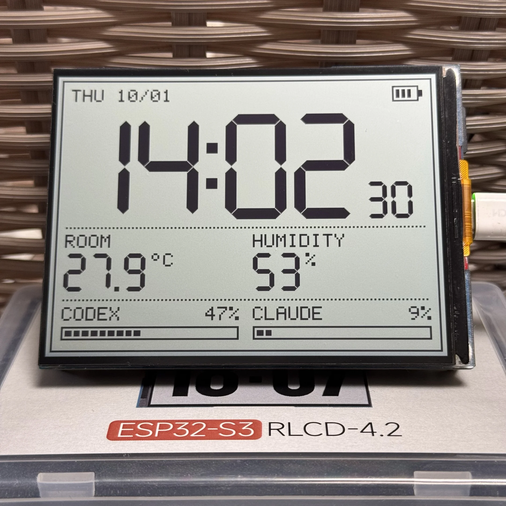
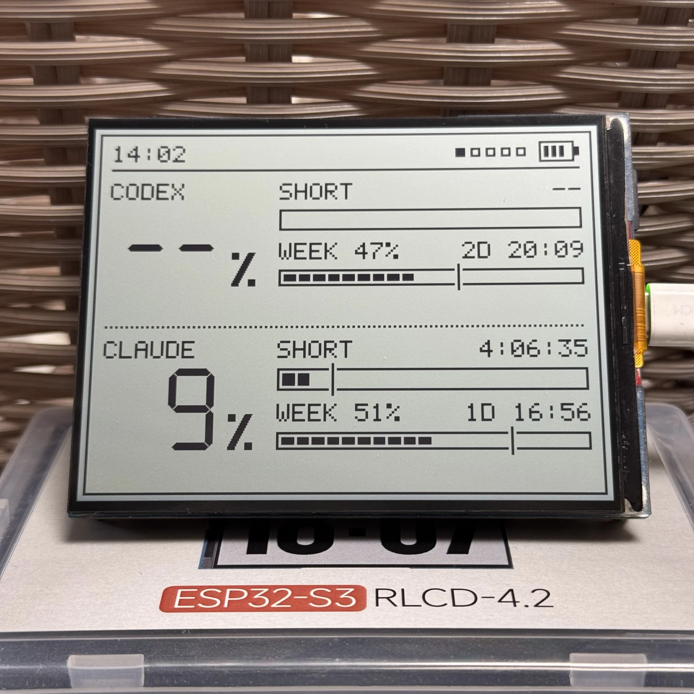
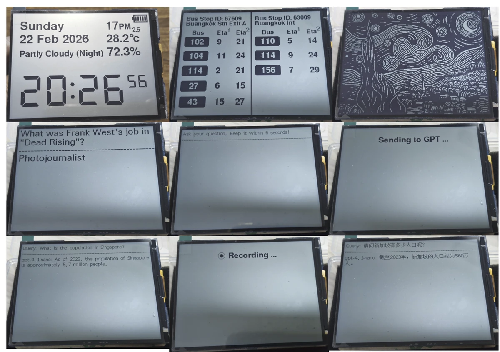
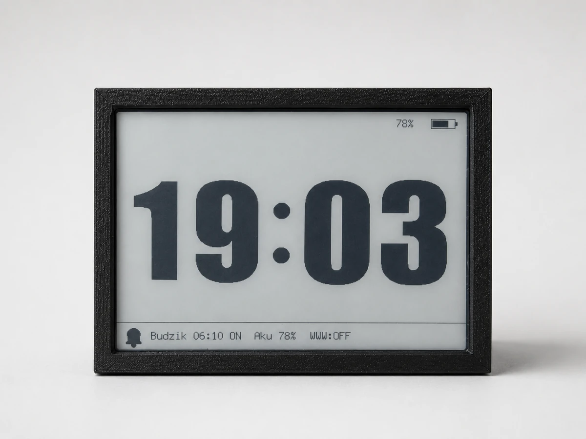
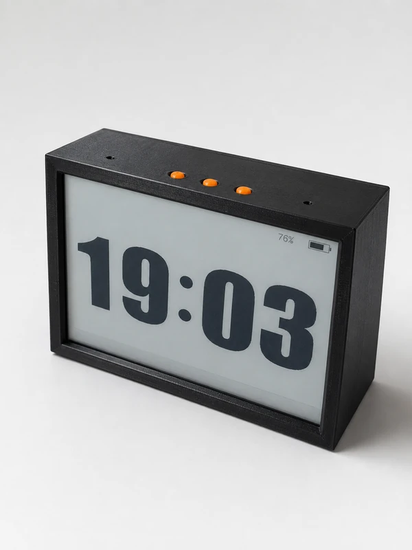
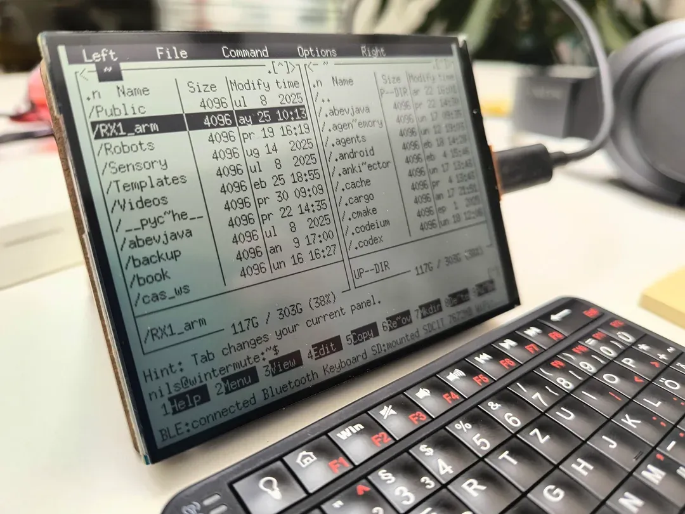
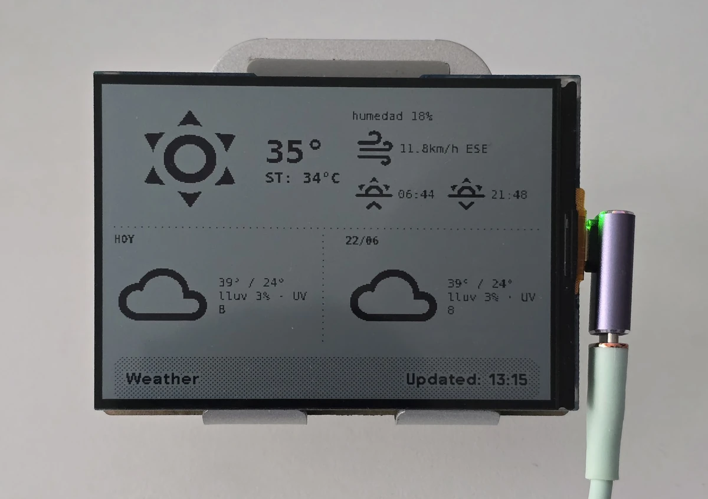
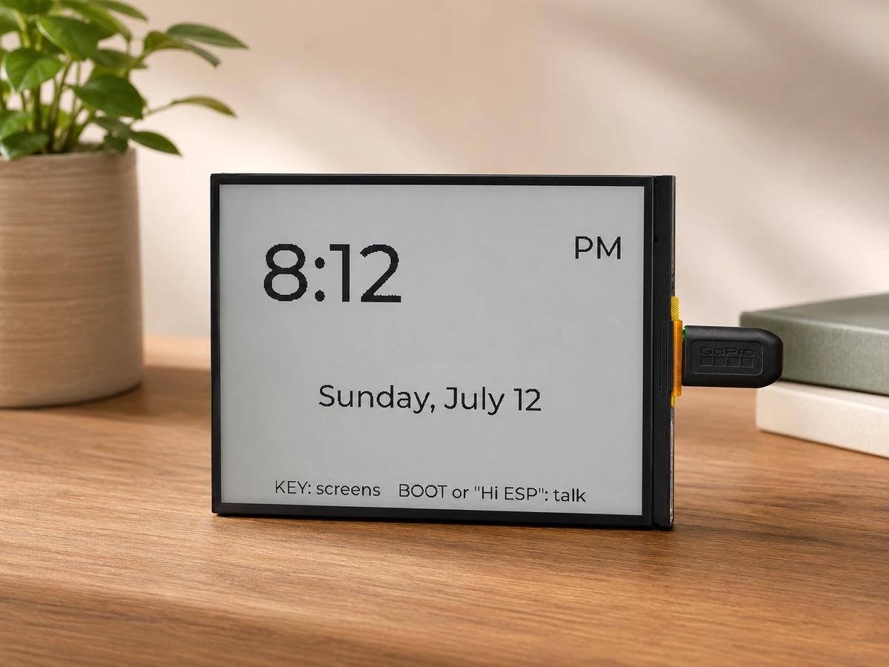
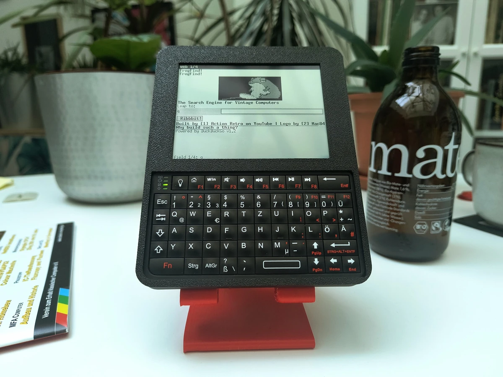

# 相关资料

> 来源: https://docs.waveshare.net/ESP32-S3-RLCD-4.2/Resources-And-Documents

## 1. 示例程序

- [ESP32-S3-RLCD-4.2 示例程序（Gitee 仓库）](https://gitee.com/waveshare/ESP32-S3-RLCD-4.2)
- [ESP32-S3-RLCD-4.2 示例程序包](https://files.waveshare.net/wiki/ESP32-S3-RLCD-4.2/ESP32-S3-RLCD-4.2-Demo.zip)
- [ESP32-S3-RLCD-4.2 示例程序（GitHub 仓库）](https://github.com/waveshareteam/ESP32-S3-RLCD-4.2)

## 2. 硬件资料

- [ESP32-S3-RLCD-4.2 原理图](https://www.waveshare.net/w/upload/e/e6/ESP32-S3-RLCD-4.2-schematic.pdf)
- [ESP32-S3-RLCD-4.2 V1 版本结构与尺寸](https://www.waveshare.net/w/upload/f/f2/ESP32-S3-RLCD-4.2-3dFile.rar)
- [ESP32-S3-RLCD-4.2 V2 版本结构与尺寸](https://www.waveshare.net/w/upload/9/91/ESP32-S3-RLCD-4.2_20261010.zip)

## 3. 技术手册

- **ESP32-S3 芯片官方手册**

  - 技术规格书：[中文版](https://documentation.espressif.com/esp32-s3_datasheet_cn.pdf) | [英文版](https://documentation.espressif.com/esp32-s3_datasheet_en.pdf)
  - 技术参考手册：[中文版](https://documentation.espressif.com/esp32-s3_technical_reference_manual_cn.pdf) | [英文版](https://documentation.espressif.com/esp32-s3_technical_reference_manual_en.pdf)
- **数据手册**

  - [ST7305 数据手册](https://www.waveshare.net/w/upload/5/5d/ST_7305_V0_2.pdf)
  - [ES8311 数据手册](https://www.waveshare.net/w/upload/6/65/ES8311.DS.pdf)
  - [PCF85063 数据手册](https://www.waveshare.net/w/upload/c/c0/Pcf85063atl1118-NdPQpTGE-loeW7GbZ7.pdf)
  - [SHTC3 数据手册](https://www.waveshare.net/w/upload/3/33/SHTC3_Datasheet.pdf)

## 4. 社区示例展示

> **信息**
>
> 以下项目由社区创作者独立维护，微雪无法提供技术支持，相关内容以项目页面为准。

### eMUQI - QuotaFrame AI 用量显示

时钟界面。图片来源：eMUQI — [QuotaFrame 项目](https://github.com/eMUQI/QuotaFrame)。

用量详情。图片来源：eMUQI — [QuotaFrame 项目](https://github.com/eMUQI/QuotaFrame)。

QuotaFrame 在 ESP32-S3-RLCD-4.2 上显示 Codex 和 Claude 的用量百分比及额度重置倒计时，数据由桌面端 Bridge 通过蓝牙发送。

- 项目主页：<https://quotaframe.com/>
- 固件与桌面端源码（GitHub 仓库）：<https://github.com/eMUQI/QuotaFrame>

### 会说话的桌面 AI 助手（番茄钟/备忘录/音乐）

视频教程：<https://www.bilibili.com/video/BV1PsfhBCEqA>

- Bilibili: <https://www.bilibili.com/video/BV1PsfhBCEqA>
- GitHub: <https://github.com/ZhouhaoJiang/xiaozhi-esp32>
- 外壳模型: [MakerWorld](https://makerworld.com.cn/zh/models/2193615-hui-shuo-hua-de-zhuo-mian-ai-zhu-shou-fan-qie-zhon#profileId-2462674)

### Volos Projects - RLCD 显示示例

- GitHub: <https://github.com/VolosR/waveshareLRCL>

### J H - RLCD 智能时钟

图片来源：JasonHEngineering，[RLCD 智能时钟界面原图](https://github.com/user-attachments/assets/17733e5d-e06e-40ba-b1f4-c91c242011e1)。

- GitHub: <https://github.com/JasonHEngineering/waveshare_RLCD_400x300_monochrome>

### Volos Projects - 电动自行车仪表

- GitHub: <https://github.com/VolosR/eBikeRLCD>

### Rubikrubi - NTP 时钟与 MP3 闹钟

图片来源：Rubikrubi — [zegar-WAVESHARE-ESP32-S3-4-2-cala-RLCD 图片](https://raw.githubusercontent.com/Rubikrubi/zegar-WAVESHARE-ESP32-S3-4-2-cala-RLCD/d68b1a7f34d00fed613926f804ea08809cdc6e01/foto%201.png)。

图片来源：Rubikrubi — [zegar-WAVESHARE-ESP32-S3-4-2-cala-RLCD 图片](https://raw.githubusercontent.com/Rubikrubi/zegar-WAVESHARE-ESP32-S3-4-2-cala-RLCD/d68b1a7f34d00fed613926f804ea08809cdc6e01/foto%202.png)。

- GitHub: <https://github.com/Rubikrubi/zegar-WAVESHARE-ESP32-S3-4-2-cala-RLCD>

### Marton Juhasz - SolarOS 运行环境

图片来源：Marton Juhasz（nilseuropa），见 [SolarOS 项目展示](https://www.reddit.com/r/cyberDeck/comments/1uemtp6/solaros/)。

- GitHub: <https://github.com/nilseuropa/solar_os>

### Lalo - TRMNL 信息显示固件

图片来源：la-lo-go — [trmnl-waveshare-esp32-s3-rlcd-4.2 图片](https://raw.githubusercontent.com/la-lo-go/trmnl-waveshare-esp32-s3-rlcd-4.2/a4ca7257247aac667aabca94d7ce76e1bb6cdc3d/docs/image.png)。

- GitHub: <https://github.com/la-lo-go/trmnl-waveshare-esp32-s3-rlcd-4.2>

### SixSigmaEngineer - RLCD 时钟

图片来源：SixSigmaEngineer — [waveshareesp32clock 图片](https://raw.githubusercontent.com/SixSigmaEngineer/waveshareesp32clock/f15f003f9aad6de4747156146324e1cedf38515a/images/clock-face.png)。

- GitHub: <https://github.com/SixSigmaEngineer/waveshareesp32clock>

### Marton Juhasz - SolarTerm 便携终端外壳

图片来源：nilseuropa — [solar\_term 图片](https://raw.githubusercontent.com/nilseuropa/solar_term/2c645f58da0f34550f0ebea708c507698cbce51c/doc/rlcd/oribuild.jpg)。

- GitHub: <https://github.com/nilseuropa/solar_term>

### Movie Vertigo - Bubble Universe 动画

- GitHub: <https://github.com/movievertigo/Waveshare-RLCD4.2-BubbleUniverse/>
