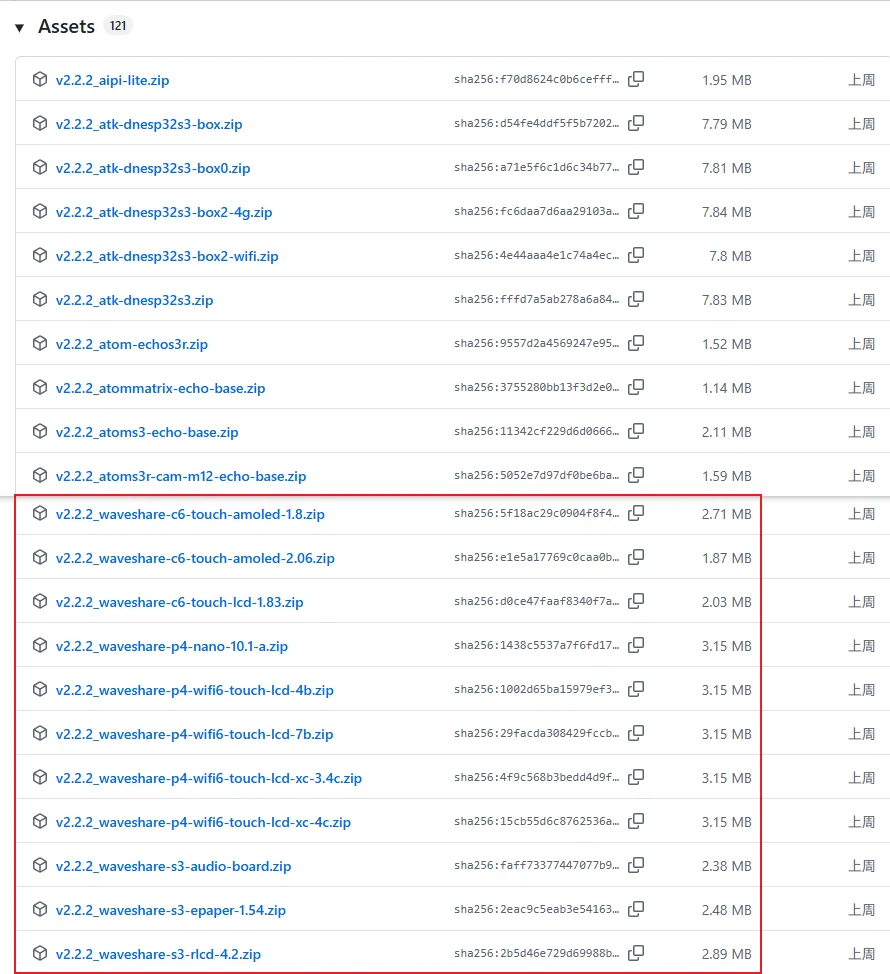
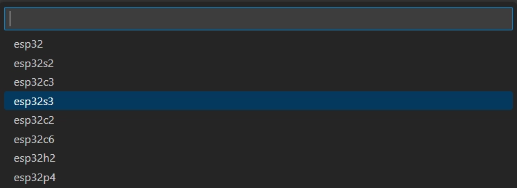
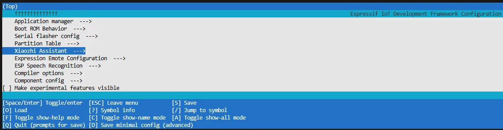
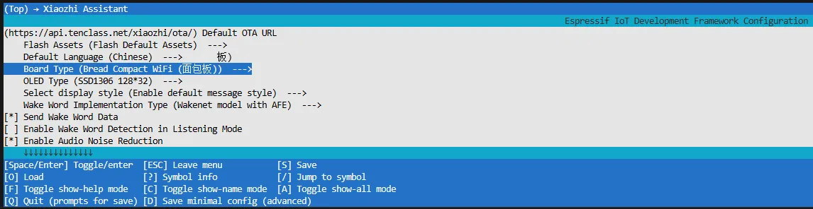
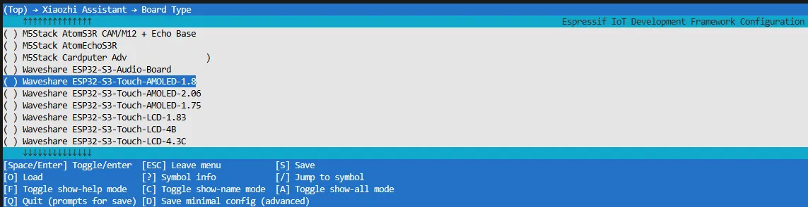
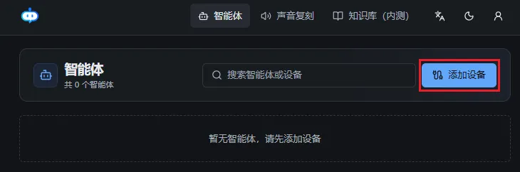
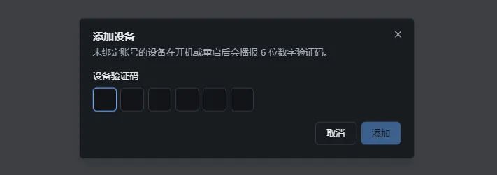

# ESP32-S3-RLCD-4.2 小智 AI 应用教程

> 来源: https://docs.waveshare.net/ESP32-S3-RLCD-4.2/XiaoZhi_AI

[XiaozhiAI](https://github.com/78/xiaozhi-esp32)（小智 AI）是一个基于 ESP32 开发板的开源 AI 语音聊天机器人项目，旨在将大语言模型（LLM）的通用智能赋予边缘设备。它提供了一套软硬件结合的解决方案，支持全双工语音对话及 IoT 设备控制，致力于协助开发者低成本、快速地构建高定制度的实体 AI 智能体。

本文演示如何为微雪电子支持小智 AI 的 ESP32 开发板烧录固件，包括**无开发环境烧录**（直接烧录预编译固件）和**有开发环境烧录**（从源码编译并烧录）两种方式。

## 0. 烧录固件流程参考

> **信息**
>
> 本文以 **ESP32-S3-Touch-AMOLED-1.8** 开发板为例进行演示，若使用其他开发板，操作步骤类似。
>
> 请先确认你的硬件在 **[小智 AI 适配产品列表](https://docs.waveshare.net/ESP32-S3-RLCD-4.2/ESP32-AI-Tutorials#xiaozhi-supported-products)** 中。

## 1. 无开发环境烧录

### **1.1 通过小智官方 GitHub 下载固件**

1. 访问 [小智 GitHub](https://github.com/78/xiaozhi-esp32/releases) 下载对应设备的固件文件，点击 **Assets** 展开全部文件列表：

   
2. 参考 [Flash 固件的烧录与擦除教程](https://www.waveshare.net/wiki/Flash%E5%9B%BA%E4%BB%B6%E7%9A%84%E7%83%A7%E5%BD%95%E4%B8%8E%E6%93%A6%E9%99%A4) 完成固件烧录。

### **1.2 通过微雪电子 GitHub 下载固件**

> **信息**
>
> [**此仓库**](https://github.com/waveshareteam/ESP32-AIChats/tree/master/xiaozhi-esp32) 汇总了微雪电子支持小智 AI 的 ESP32 开发板固件，所有固件均已在对应开发板上测试验证，方便用户集中查找和下载。固件版本更新可能略晚于小智官方仓库。

1. 访问 [微雪 GitHub](https://github.com/waveshareteam/ESP32-AIChats/tree/master/xiaozhi-esp32) 仓库，根据需求选择合适版本的固件进行下载：

   
2. 参考 [Flash 固件的烧录与擦除教程](https://www.waveshare.net/wiki/Flash%E5%9B%BA%E4%BB%B6%E7%9A%84%E7%83%A7%E5%BD%95%E4%B8%8E%E6%93%A6%E9%99%A4) 完成固件烧录。

## 2. ESP-IDF 环境烧录

### **2.1 通过小智 GitHub 下载工程**

访问 [XiaoZhi AI Chatbot](https://github.com/78/xiaozhi-esp32) 仓库下载完整工程代码：

### **2.2 环境搭建**

参考 [ESP-IDF 环境搭建教程](https://docs.waveshare.net/ESP32-ESP-IDF-Tutorials/ESP-IDF-Installation) 完成开发环境的配置。

### **2.3 配置编译**

1. 点击  选择目标设备，根据您的开发板选择对应的芯片型号（如 `esp32s3`）：

   

   > **提示**
   >
   > 设置目标设备时，ESP-IDF 会自动配置相应的工具链和库，此过程可能需要一些时间，请耐心等待。更多详情请参阅 [官方文档](https://docs.espressif.com/projects/esp-idf/zh_CN/latest/esp32s3/api-guides/tools/idf-py.html#set-target)。
2. 点击  打开 ESP-IDF 终端，执行 `idf.py menuconfig` 命令进入配置界面，选择 **Xiaozhi Assistant**:

   
3. 选择 **Board Type** 进入开发板类型选择：

   
4. 选择与您的开发板对应的产品型号：

   
5. 按 **S** 键保存配置并退出，然后点击  一键构建、烧录和监视图标，自动完成编译、烧录和串口监视。

### **2.4 开始配网**

1. 使用手机或电脑连接设备的 WiFi 热点：**Xiaozhi-xxxxxx**。连接成功后通常会自动跳转到配置页面，若未自动跳转，请手动在浏览器中访问 `http://192.168.4.1`。
2. 在网络配置页面选择要连接的 WiFi 名称（仅支持 **2.4G** 频段；若要连接 iPhone 热点，需在手机系统设置中开启**最大兼容性**），SSID 将自动填入，输入密码后点击 **Connect** 开始连接：

   

### **2.5 添加新设备到管理后台**

1. 确保设备已成功连接到互联网，此时设备会播报 6 位设备验证码（可重复唤醒设备再次播报）。
2. 访问 [小智 AI 控制面板](https://xiaozhi.me)，如未注册请先完成账号注册并登录：

   

   
3. 输入 6 位验证码后，设备将自动激活并显示在**设备管理**页面，即可正常使用。

   

   
4. 说出唤醒词 **"你好，小智"** 即可唤醒设备，开始语音对话。
5. **ESP32-S3-Touch-AMOLED-1.8** 按键说明：

   - **BOOT** 按键：按下可唤醒小智
   - **PWR** 按键：短按开机，长按 6 秒以上关机

## 3. 小智资料

- [小智 AI 聊天机器人百科全书](https://ccnphfhqs21z.feishu.cn/wiki/F5krwD16viZoF0kKkvDcrZNYnhb)
- [小智 AI 聊天机器人常见问题及解答](https://rcnv1t9vps13.feishu.cn/wiki/JiQowaSe1itt07kyVvZcHFcQnee)

## 4. 常见问题 Q&A

问：某款 ESP 产品可以接入小智吗？

答：ESP32 系列芯片基本都可以接入 AI 大模型，但具体应用方式取决于硬件配置。如果产品配备了麦克风和扬声器，可实现语音对话功能；若没有这些外设，则只能进行文字对话（部分产品支持外接麦克风和扬声器）。

问：目前哪些产品已适配小智？

请查看 [小智 AI 适配产品列表](https://docs.waveshare.net/ESP32-S3-RLCD-4.2/ESP32-AI-Tutorials#xiaozhi-supported-products)。

问：不插入 SD 卡可以进行小智对话吗？

答：可以，不插入 SD 卡也能正常使用小智进行对话。

问：小智固件升级后会自动更新吗？

答：在小智控制面板中开启 **OTA 升级**功能后，固件会自动更新，无需手动重新烧录。

问：适配小智的产品连接的是小智服务端吗？可以连接客户自己的服务端吗？

答：默认连接小智官方服务端。理论上也可以连接客户自己的服务端，需要进行相应的配置修改。

问：小智可以离线使用吗？

答：不可以离线使用，小智需要连接互联网才能正常工作。

问：小智可以读取 SD 卡里的文件吗？

答：目前小智暂不支持读取 SD 卡中的文件。

问：适配小智的产品可以接入 DeepSeek、ChatGPT 等其他 AI 吗？

答：可以接入其他 AI 服务，但需要用户自行开发实现。

问：刷入小智后，原来的程序还能用吗？能否一键切换？

答：不能。示例程序与小智固件是两个独立的程序，无法同时使用或一键切换，需要重新烧录固件才能切换。

问：小智可以连接手机热点吗？

答：可以，只要是 **2.4G 频段**的热点即可（不支持 5G 频段）。
