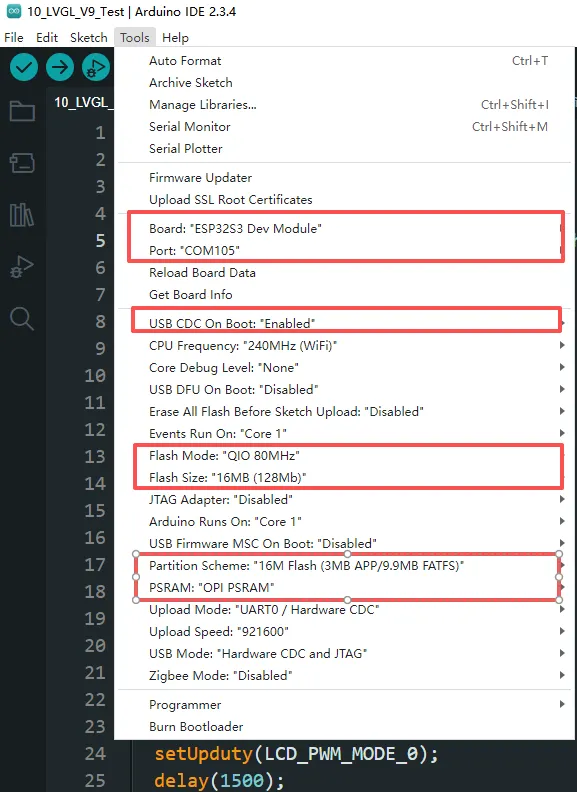

# 产品 FAQ

> 来源: https://docs.waveshare.net/ESP32-S3-RLCD-4.2/FAQ

问：电池充满电可以使用多久？

- 出厂程序待机模式下测试可以正常跑24小时左右。

 问：开发板的功耗是多少？

- 出厂程序下功耗数据：5.32V,0.09A。不同程序功耗不同，用户可以根据运行的程序实际测试具体功耗。

 问：更换 18650 电池需要注意什么？

- 本模块需要使用标准的 **18650 锂可充电电池**。
- **特别注意**：安装或更换电池时，请务必轻拿轻放，**避免用力按压屏幕**，以免造成屏幕破损。

 问：设备如何开关机？

- **开机**：单击 **PWR** 按键。
- **关机**：长按 **PWR** 按键。

 问：使用电池供电为什么无法开机？

- 安装电池之后，需要同时接入type-c供电激活下设备才可以。开机之后可以断开type-c线的连接，电池可以保持开发板供电。

 问：为什么 RLCD 屏幕看起来没有亮度，甚至有些暗？

- **RLCD (Reflective LCD)** 为全反射式屏幕，其原理是利用环境光反射成像，**本身不具备背光灯**。
- **特点**：在光线越充足的环境下（如阳光下或强光灯下），显示效果越清晰。这种设计极大地降低了功耗，且长时间观察不易引起视觉疲劳。

 问：RTC 备用电池座应该使用什么型号的电池？

- 必须使用 **可充电锂电池 (Secondary Lithium Battery)**，推荐型号为 **ML1220** 或兼容的 3V/3.3V 可充电纽扣电池。
- **注意**：请勿使用不可充电的普通纽扣电池（如 CR1220），否则在接入主电源充电时可能会损坏电池或电路。

 问：模块下载程序后，重新下载，有时会出现无法连接串口，或者烧录失败的情况？

- 可长按 BOOT 按键，重新上电，此时模块可进入下载模式，可解决大部分无法下载的问题。

 问：VSCode (ESP-IDF) 环境搭建失败？

- 大多数环境配置失败是由网络连接不稳定导致的，建议尝试切换其他网络环境（如移动热点）重试。
- 确保路径中不包含中文字符或空格，这可能会导致编译链工具运行异常。

 问：使用 Arduino IDE 编译程序报错？

- 请对照产品文档，确认 **Arduino IDE** -> **Tools** 菜单中的各项配置是否正确（特别是芯片型号、Flash 模式、PSRAM 等设置）。

  

 问：程序首次编译速度非常慢？

- 首次编译需要下载依赖库并构建大量的架构底层缓存，这通常需要较长时间，请耐心等待完成。
- 完成首次编译后，后续的增量编译速度将大大提升。

 问：找不到 AppData 文件夹？

- `AppData` 文件夹在 Windows 系统中默认是隐藏的，可以通过以下设置显示：
- **Windows 10/11 (中文)**：文件资源管理器 -> 查看 -> 显示 -> 勾选 **“隐藏的项目”**。
- **Windows 10/11 (English)**: File Explorer -> View -> Show -> Check **"Hidden items"**.

 问：如何确认设备使用的 COM 端口号？

**Windows 系统**：

1. 通过设备管理器查看： 按下 `Windows` + `R` 键打开“运行”对话框； 输入 `devmgmt.msc` 并按回车键打开设备管理器； 展开“端口（COM 和 LPT）”部分，这里会列出所有的 COM 端口及其当前状态。
2. 使用命令提示符查看： 打开命令提示符（CMD）； 输入 `mode` 命令，这将显示所有 COM 端口的状态信息。
3. 查看硬件连接： 如果你已经连接了外部设备到 COM 口，通常设备会占用一个端口号，可以通过查看连接的硬件来确定使用的是哪个端口。

**Linux 系统**：

1. 使用 `dmesg` 命令查看： 打开终端。
2. 使用 `ls` 命令查看： 输入 `ls /dev/ttyS*` 或 `ls /dev/ttyUSB*` 来列出所有的串口设备。
3. 使用 `setserial` 命令查看： 输入 `setserial -g /dev/ttyS*` 来查看所有串口设备的配置信息。

 问：如何使用 SquareLine Studio 设计界面？

- 请参考详细教程：**[SquareLine Studio 使用教程](https://www.waveshare.net/wiki/Waveshare_SquareLine_Studio)**。
